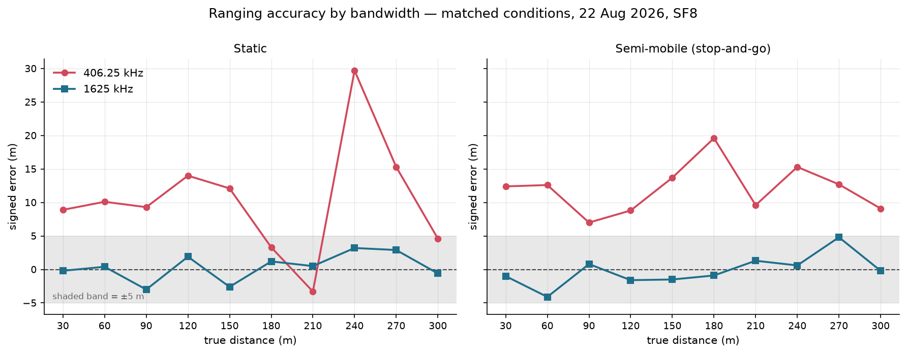
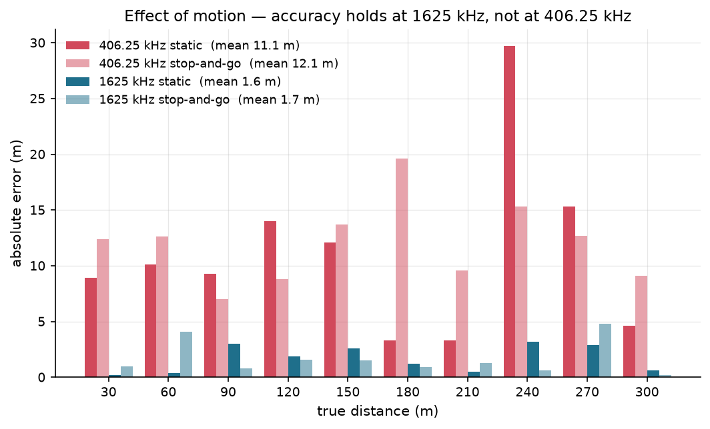
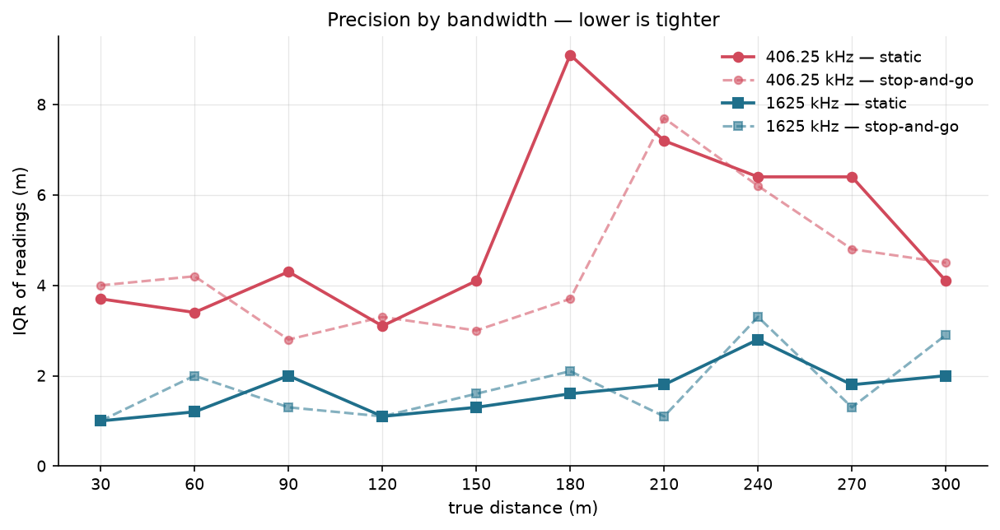

# Pack Pucks

**An open, commodity-hardware platform for peer-to-peer 2.4 GHz radio ranging — and the
field measurements it has produced.**

Two matchbox-sized devices tell each other how far apart they are, using nothing but the
travel time of a 2.4 GHz radio signal between them. No GPS. No phone. No cloud. No fixed
anchors. The measurement build shows the distance on each board's OLED display; a separate
demonstration build maps it to a colour on an LED ring, and that build produced none of
the data here.

The demo is the easy half. The point of this repository is the measurement: firmware,
offload and QC tooling, the raw CSVs from every outing, and the analysis that produced
every number below — published so the ranging behaviour of the SX1280 on off-the-shelf
hardware can be checked rather than taken on trust.

> ### Headline result (one matched session)
>
> **22 August 2026 · ten tape-surveyed cones at 30 m spacing, 30–300 m · SF8 · both
> bandwidths run back to back on the same line**
>
> Out of the box, **1625 kHz** was more accurate and more precise. Its median range error
> stayed inside **±5 m at every marker**, both with both endpoints static and with one
> endpoint hand-held, with a mean absolute error of **1.6 m** and **1.7 m**. At
> **406.25 kHz** errors ran **10 to 12 m long on average**: most of the error was a
> positive offset. With that offset estimated in the other tier and removed, the
> 406.25 kHz mean absolute error was **6.2 m** static and **3.1 m** hand-held, against
> 1.7 m, a hand-held difference these data do not resolve, while its spread stayed
> **2.5 to 3.1 times wider**. The 406.25 kHz ranging cycle was 4.7 % longer (686 ms
> against 655 ms).
>
> **5,760 logged ranging exchanges on 22 August, retaken files included: zero
> timeouts, zero errors**, so readings offset by about 10 m arrived with a success status.
>
> Repeatability across days is not established: the comparison rests on one session
> (see [What these numbers do not say](#what-these-numbers-do-not-say)).

## What this repository contributes

The three contributions of the Part 1 preprint:

1. **Platform.** An open platform for peer-to-peer SX1280 ranging on off-the-shelf
   boards, released with its firmware, data and analysis scripts.
2. **Bandwidth choice for a hand-held peer.** A matched 406.25 against 1625 kHz
   comparison from 30 to 300 m with one endpoint hand-held as well as with both static,
   at the markers and on the walks between them.
3. **Practitioner observations.** How a post-hoc median-of-3 filter changes bias and
   spread, the radio's outcome record, the recorded field disturbances and their
   retakes, and how Initiator signal strength relates to ranging error (it did not track
   it within a marker).

| Where to look | |
|---|---|
| [`data/README.md`](data/README.md) | Datasets — sites, weather, per-session provenance, every field deviation |
| [`data/analysis/2026-08-22_GMATownship_day2_tables_discard5s.md`](data/analysis/2026-08-22_GMATownship_day2_tables_discard5s.md) | The per-marker tables behind every figure here (first 5 s of each marker discarded) |
| [`data/analysis/aggregates.md`](data/analysis/aggregates.md), [`uncertainty.md`](data/analysis/uncertainty.md) | The aggregates below, and their bootstrap and slope intervals |
| [`data/analysis/review_followup.md`](data/analysis/review_followup.md) | The offset-removed accuracy and the spread ratios, with intervals |
| [`data/analysis/c2_walking.md`](data/analysis/c2_walking.md) | The walks between markers, against a constant-pace reference |
| [`docs/ground_truth_tolerance.md`](docs/ground_truth_tolerance.md) | How the ground-truth bound was derived |
| [`firmware/`](firmware/) | Arduino/C++ sources, both roles, by build phase |
| [`docs/FSD.md`](docs/FSD.md) | Functional specification — requirements, pin map, CSV schemas |
| [`tools/`](tools/) | Offload, CSV validation, session QC, analysis scripts, figure generation |

---

## Why build it

A group spread out along a forest trail, a trailhead, or a construction site has no
reliable way to answer *"how far away is everyone?"* GPS needs sky, mesh radios need a
network, and phones need both. Two pucks need only each other.

Pack Pucks is **GPS-independent by design** — no GPS receiver, no cellular link, no cloud
service, no fixed anchors. It has **not** been tested in GPS-denied conditions, and no
such claim is made: every measurement in this repository is outdoor and line-of-sight.
The system's output is a coarse range estimate; the LED colour bands are a demonstration
use case, not a research result.

---

## Paper and citation

The Part 1 preprint, *Pack Pucks: An Open, Reproducible Platform for Peer-to-Peer
SX1280 LoRa Ranging and a Field Comparison of Its Bandwidth Extremes*, covers the
platform and this characterisation; its arXiv identifier will be added here. The full
experimental protocol (`Methodology.md`) is available on request.

To cite this repository (firmware, tools and data, release `v1.0.1-preprint`):

```bibtex
@misc{raonka2026packpucks,
  author = {Ishan Raonka},
  title  = {Pack Pucks: An Open, Reproducible Platform for Peer-to-Peer {SX1280}
            {LoRa} Ranging and a Field Comparison of Its Bandwidth Extremes},
  year   = {2026},
  note   = {Firmware, tools and data, release v1.0.1-preprint},
  url    = {https://github.com/raonka/Pack-Puck},
  doi    = {10.5281/zenodo.24120237}
}
```

Archived on Zenodo (release `v1.0.1-preprint`): DOI [10.5281/zenodo.24120237](https://doi.org/10.5281/zenodo.24120237).

---

## Quick start

**Hardware.** Two LILYGO T3-S3 V1.2 boards (SX1280, the variant without a power
amplifier), each with its SMA stub antenna screwed on before power-up, in a 3D-printed
case held in a phone clamp on a 1.5 m camera tripod, powered from its own USB-C power
bank. Full parts list: [Build one](#build-one).

**Build and flash.** Arduino IDE 2.3.8, arduino-esp32 3.3.5, RadioLib 7.6.0, U8g2 2.35.30
([Toolchain](#toolchain)). Tools menu: Board **LilyGo T3-S3**, Board Revision
**Radio-SX1280**, USB CDC On Boot **Enable**, Partition Scheme **Default 4MB with spiffs
(1.2MB APP / 1.5MB SPIFFS)**, PSRAM **QSPI PSRAM**, Upload Mode **UART0/Hardware CDC**.
Flash `firmware/03_ranging/03_initiator/` to one board and `firmware/03_ranging/03_responder/`
to the other (the role is the sketch). Set `RADIO_BW_KHZ` to `1625.0f` or `406.25f` in
both sketches and reflash both for each bandwidth.

**Running a session.** The Responder stays at the reference position; the Initiator moves
to each marker, and each power-on starts a new log file. Its OLED shows distance, RSSI,
state and failure count (title `!! SPIFFS FAIL !!` if logging has stopped). Hold each
marker for about 70 s: the analysis discards the first 5 s as settling.

**Offload.** With pyserial installed, reset or replug the puck and run straight away:

```bash
python tools/offload/offload.py --port COM7 --session-id 20260822_site
```

This one command enters offload mode in the boot window, lists, downloads and validates
every log, writes `manifest.txt`, and offers to erase the flash only if every file is
intact and you type `YES`. Files land in `./offload/<session-id>-<Role>/` (`--out-dir`
changes the parent; `--no-metadata` skips the operator prompts; `-v` echoes the traffic).

**Analysis.** From the repository root, with Python and matplotlib, in this order:

```bash
for s in per_marker_tables aggregates c3_filters c4_failure_modes dwell_table uncertainty \
         rssi_disturbance c2_walking review_followup make_readme_figures make_latex_tables
do python tools/$s.py; done
```

This regenerates every table and figure behind the preprint
([Reproducing every figure](#reproducing-every-figure)).

---

## What was measured

| | |
|---|---|
| Site | Open ground, GMA township, Kota, Rajasthan |
| Markers | 10 traffic cones, 30 m spacing, 30 m → 300 m, tape-surveyed |
| Radio | SX1280 @ 2400.0 MHz, SF8, CR 4/7, 12 dBm, address `0x12345678` |
| Calibration | Out of the box: RadioLib 7.6.0's default per-bandwidth calibration constants, no per-device calibration |
| Independent variable | **Bandwidth: 406.25 kHz vs 1625 kHz.** |
| Mounts | Each puck in a phone clamp on a 1.5 m camera tripod, antennas vertical, the pucks facing each other; one USB-C power bank per puck |
| Roles | The Responder stays at the reference position; the Initiator, which shows its latest reading on its display, is the puck moved to each marker |
| Tier 1, static | The Initiator's tripod stands at each marker; one boot per marker, ascending 30 m to 300 m |
| Tier 2, hand-held | The operator carries the Initiator's tripod upright, with its power bank in a pocket, and holds it on each cone mark, standing behind it on the side away from the Responder, for a ~70 s dwell; walked between cones in one boot, 300 m to 30 m |
| Sample size | 82–122 attempts per marker after discarding the first 5 s at each marker |
| Tier 2 ground truth | The operator's stopwatch lap log: a phone stopwatch lapped at the end of every dwell and every walk |

Both bandwidths ran back to back on the same cone line, the same afternoon, at the same
spreading factor and the same power, 406.25 kHz first. This is one matched session: the
sweep order was not reversed, ranging is frequency-uncorrected, and the only temperature
reading was taken at 15:07, so drift between the two sweeps cannot be excluded.

---

## Results

All results in this section are from the 22 August session.

### 1. Most of the 406.25 kHz error was an offset; its spread stayed wider



| | 406.25 kHz | 1625 kHz | Ratio 406.25 / 1625 |
|---|---|---|---|
| Mean absolute error, static | 11.1 m [7.1, 16.1] | **1.6 m** [0.9, 2.3] | 6.8× [4.8, 9.9] |
| Mean absolute error, hand-held | 12.1 m [10.0, 14.3] | **1.7 m** [0.9, 2.7] | 7.2× [4.5, 14.1] |
| Mean signed error, static | **+10.4 m** [+5.6, +15.8] | +0.4 m [−0.9, +1.5] | |
| Mean signed error, hand-held | **+12.1 m** [+10.0, +14.3] | −0.2 m [−1.5, +1.3] | |
| Mean absolute error, offset removed, static | 6.2 m [2.9, 10.2] | 1.7 m [1.1, 2.4] | 3.7× [1.5, 7.6] |
| Mean absolute error, offset removed, hand-held | 3.1 m [1.8, 6.8] | 1.7 m [0.9, 2.9] | 1.8× [0.7, 5.5] |
| Mean IQR, static | 5.2 m | **1.7 m** | 3.1× [2.5, 3.9] |
| Mean IQR, hand-held | 4.4 m | **1.8 m** | 2.5× [1.9, 3.5] |
| Worst single marker, static | **+29.7 m** (at 240 m) | +3.2 m (at 240 m) | |

Each cell aggregates ten per-marker values, where a marker's value is the median (or IQR)
of the SUCCESS rows recorded at it, after discarding the first 5 s at each marker
(Methodology §7.2). Brackets are 95 % percentile intervals of a bootstrap over the ten
markers (10,000 resamples, fixed seed); the MAE ratio is paired by marker. Per-marker
tables are in
[`data/analysis/2026-08-22_GMATownship_day2_tables_discard5s.md`](data/analysis/2026-08-22_GMATownship_day2_tables_discard5s.md);
intervals in [`data/analysis/uncertainty.md`](data/analysis/uncertainty.md).
"Offset removed" corrects each tier by the mean signed error of the *other* tier at the
same bandwidth, so the offset is not fitted to the markers it corrects; the bootstrap
re-estimates it in every resample. With the offset removed, the hand-held ratio's
interval includes parity: these data do not resolve an accuracy difference there, while
the spread stayed wider at 406.25 kHz in both tiers. Values and intervals:
[`data/analysis/review_followup.md`](data/analysis/review_followup.md).

The 406.25 kHz error is **directional, not noisy** — distances came back too long at nine
of ten markers when static, and at ten of ten when hand-held. No slope against distance
was detectable at this sample size: the 95 % interval for the static slope is −0.070 to
+0.086 m/m, which allows a change of −19.0 to +23.2 m over the 270 m span. A fixed delay
error and an uncancelled oscillator offset would both produce a distance-independent
term, and these data cannot separate them.

### 2. Holding one endpoint by hand changed little at 1625 kHz



At 1625 kHz, mean absolute error was **1.6 m with both endpoints static and 1.7 m with
one hand-held**. At 406.25 kHz it rose from 11.1 to 12.1 m. The two tiers also differ in
boot mode, sweep direction and time of recording, so a difference between them is not
attributable to hand-holding alone.

**What "hand-held" means here, precisely.** The Initiator sits in a phone clamp on its
1.5 m tripod, which the operator carries upright and holds on each cone mark, standing
behind it on the side away from the Responder; the Responder stays at the reference
position. Between cones the operator walks to the next one (a stop-and-go procedure).
The main comparison uses the ~70 s dwell at each cone, where the hand-held endpoint is
stationary. The walks between cones are analysed separately against a constant-pace
reference: 1625 kHz stayed ahead, with a mean absolute error of 3.9 m against 13.0 m.
See [`data/analysis/c2_walking.md`](data/analysis/c2_walking.md).

Dwell windows come from the operator's stopwatch lap log rather than being inferred from the data.
Where that log disagrees with the QC tool's nearest-marker heuristic — two of ten markers
at 406.25 kHz — the lap-window recomputation supersedes the tool, and the tool's own
report is left as generated so the disagreement stays visible.

### 3. Precision held out to 300 m



1625 kHz stayed between **1.0 m and 3.3 m** of interquartile spread across the whole
30–300 m span. 406.25 kHz ran **2.8 m to 9.1 m**; its widest values (6.2 to 9.1 m) all
fall between 180 and 270 m.

### 4. The narrower bandwidth lengthened the cycle by 4.7 %

Ranging cadence is the duration of the whole firmware loop (the blocking RadioLib
`range()` call, the log write and the OLED refresh), with no software pacing:

| Bandwidth | Cycle time | Rate | Basis |
|---|---|---|---|
| 1625 kHz | **655 ms** | 1.53 Hz | median of 2,649 inter-row intervals |
| 406.25 kHz | 686 ms | 1.46 Hz | median of 3,084 inter-row intervals |

Cutting bandwidth by 4× added only **4.7 %** (31 ms) to each cycle: most of the cycle is
bandwidth-independent loop time, which was not broken down further. What a cycle with no
reply costs was not measured, because neither campaign outing recorded a timeout.

### Practical reading of this session

Out of the box, 1625 kHz was more accurate (mean absolute error 6.8× lower static and
7.2× lower hand-held), more precise (spread 3.1× and 2.5× narrower) and 4.7 % faster per
cycle. Most of the 406.25 kHz error was an offset: with it removed, 406.25 kHz was still
less accurate static, the hand-held difference is not resolved, and its spread stayed
wider in both tiers. A deployment that needs the narrow setting at longer range would
have to remove that offset; whether a one-time per-device calibration does so is the
next test. Reach was not the trade-off within 300 m: neither bandwidth lost the link. A separate pilot outing at 1625 kHz was still
ranging at a **365 m** median when the ground ran out — though that outing was never
surveyed, so no accuracy figure can be read from it. These are single-session results.

---

## Where this sits in the literature

| Prior work | Hardware | Bandwidth comparison | Mobility |
|---|---|---|---|
| Wolf et al., WPNC 2019 | SX1280 evaluation board + Raspberry Pi | 406.25 vs 1625 kHz at SF10, dedicated | static |
| Andersen et al., WF-IoT 2020 | SX1280 dev-kit, demonstration firmware | every 400 / 800 / 1600 kHz × SF5–10 combination at each distance | static |
| Müller et al., ICL-GNSS 2021 | custom SX1280 + STM32 | 400 kHz (the 406.25 kHz setting) only | one node carried by a walking person |
| Gottschalk et al., *Internet of Things* 2026 | SX1280 dev-kit, anchor-based 2D | 800 vs 1600 kHz; 400 kHz tested and excluded | static |
| Albinsaid et al., arXiv 2025 | custom hardware; design and firmware released | — (1625 kHz only) | anchor-and-server localisation framework |
| Salimzhanova et al., CSCN 2024 | open SX1280 testbed | — | *communication*, not ranging |

Every bandwidth comparison above is static, and the one study with a person-carried
endpoint (Müller et al.) uses a single bandwidth. Gottschalk et al. explicitly defer
systematic low-bandwidth investigation to future work.

To the best of my knowledge, no prior work compares the 406.25 and 1625 kHz settings with
one endpoint hand-held. This repository does so, out of the box, on commodity hardware
with the raw data published, alongside an open platform for peer-to-peer ranging on
off-the-shelf boards.

The static tier is **not new**: its result is consistent with the static comparison of
Wolf et al., here on off-the-shelf parts at SF8 rather than SF10.

---

## What these numbers do not say

A short, honest list. The full version is in [`data/README.md`](data/README.md) and the
per-session logs.

- **One matched session carries the comparison.** The 406.25-vs-1625 kHz result rests on
  22 August alone. An earlier 1625 kHz-only session on 15 August, at the same road
  marks, is exploratory validation data, released but not analysed, so repeatability
  across days is not established.
- **Ground truth is bounded at about ±0.5 m at 300 m.** The class III tape allows
  ±12.6 mm per 30 m segment, and the same segment was reused ten times, so ±126 mm at
  300 m. With the lateral, mark-transfer and puck-centring terms (operator upper-bound
  estimates), the bound at 300 m is −448 / +281 mm with both endpoints static and
  −411 / +244 mm with one hand-held; the hand-held figure omits the placement of the
  hand-held end, which was not estimated. Cone-position error is shared by both
  bandwidths. Derivation: [`docs/ground_truth_tolerance.md`](docs/ground_truth_tolerance.md).
- **Retakes were decided in the field.** The operator chose which disturbed files to
  record again and could see the Initiator's display of its latest reading. At
  406.25 kHz most disturbed static markers were recorded again; at 1625 kHz every
  annotated file was kept, which works against 1625 kHz in the comparison.
- **The tripod height is in the field diary only.** It was measured on site and recorded
  in a field diary that is not in this repository.
- **Out of the box only.** Every figure uses RadioLib 7.6.0's default calibration
  constants and no per-device calibration. Ranging is single-direction and
  frequency-uncorrected, without role-swapped or multi-exchange averaging, so the figures
  are not directly comparable with the averaged results of prior work.
- **The 240 m cone stands out at both bandwidths.** +29.7 m at 406.25 kHz static against
  +3.2 m at 1625 kHz, beside a recorded structure; at 1625 kHz its IQR was the widest of
  the ten markers in both tiers (2.8 m and 3.3 m). Other markers stand out by other
  criteria (the widest 406.25 kHz IQRs were at 180 m and 210 m). On 22 August the
  operator tied back shrubs near the house at 240 to 250 m to clear the line of sight,
  with conditions the same for both bandwidths. These are recorded as observations and
  not interpreted; re-measurement is future work.
- **The pilot outing has no ground truth at all.** Its 365 m reach is a range
  demonstration; positions were paced, not surveyed. No accuracy figure is derivable
  from it.
- **Motion is measured only against a constant-pace reference.** The walks between
  cones have no ground truth of their own: the true distance along each walk is
  interpolated from the lap times at its ends, and the 1625 kHz readings are consistent
  with a pace that was not constant. See result 2 above and
  [`data/analysis/c2_walking.md`](data/analysis/c2_walking.md).

---

## Reproducing every figure

Raw CSVs are opened read-only and never modified — no ground truth was ever written back
into them, which is why per-file truth lives in `session_plan.json` instead. Every report
and figure regenerates from the published data. The per-session QC reports:

```bash
python tools/qc_session.py --data-dir data/ranging_experiments/2026-08-22_GMATownship_session02/raw/20260822_174415-Initiator --out qc_out --session-plan data/analysis/2026-08-22_GMATownship_174415_qc/session_plan.json --expect-bw 1625.0
```

For the 406.25 kHz run add `--expect-bw 406.25 --cadence-ms 686.0`. Regenerating
reproduces the committed reports exactly; only the generation timestamp differs.

The post-discard analysis and the figures above, in this order (later scripts read
earlier outputs; each writes into `data/analysis/`):

```bash
python tools/per_marker_tables.py
python tools/aggregates.py
python tools/c3_filters.py
python tools/c4_failure_modes.py
python tools/dwell_table.py
python tools/uncertainty.py
python tools/rssi_disturbance.py
python tools/c2_walking.py
python tools/review_followup.py
python tools/make_readme_figures.py
python tools/make_latex_tables.py
```

These regenerate the committed files under `data/analysis/` exactly.
`tools/make_readme_figures.py` also writes the preprint's per-marker figure
(`*_paper.png`), `tools/c2_walking.py` its walking figure, and
`tools/make_latex_tables.py` the preprint's LaTeX tables (into `paper/tables/`) from the
same outputs.

---

## Build one

### Hardware

| Component | Part |
|---|---|
| MCU + radio + display | LILYGO T3-S3 V1.2: ESP32-S3 + Semtech SX1280, the variant without a power amplifier (H594), onboard SSD1306 OLED, × 2 |
| Antenna | the 2.4 GHz SMA stub antenna supplied with the board, finger-tight |
| Power | USB-C; in the campaign, one USB-C power bank per puck |
| Mounts (measurement) | a phone clamp on a 1.5 m camera tripod per puck; the Initiator's tripod is carried upright in the hand-held tier |
| Ground truth | Freemans Grey Magic 30 m fibreglass tape, class III |
| Demonstration only | WS2812B 16-LED ring on GPIO 38, for the colour-band demonstration build; not used for any data in this repository |

Both boards run the same code with one compile-time switch. One is the Initiator and
drives the exchange; the other answers.

### Toolchain

| Component | Version |
|---|---|
| Arduino IDE | 2.3.8 |
| arduino-esp32 board package (Espressif) | 3.3.5 |
| RadioLib (Jan Gromeš) | 7.6.0 |
| U8g2 (oliver) | 2.35.30 |
| Python (analysis scripts) | 3.14.5 |
| matplotlib | 3.11.1 |

The campaign firmware was built against arduino-esp32 3.3.5 and RadioLib 7.6.0; the
Arduino IDE, U8g2, Python and matplotlib versions are those of the machine the analysis
was regenerated on. The analysis scripts need only the Python standard library and
matplotlib. **FastLED** (Daniel Garcia) is needed only for the LED-ring demonstration
build.

### Flash

1. Open the sketch for the phase you want from `firmware/`.
2. Board **LilyGo T3-S3**, Board Revision **Radio-SX1280**.
3. Enable **USB CDC On Boot**; PSRAM **QSPI PSRAM**; Partition Scheme
   **Default 4MB with spiffs**.
4. Choose the role by the sketch: for the campaign firmware, flash
   `firmware/03_ranging/03_initiator/` to one board and `firmware/03_ranging/03_responder/`
   to the other (earlier phases likewise ship one sketch per role). There is no runtime
   switching.
5. Flash both, then open Serial Monitor at 115200 baud.

The boot banner reports firmware version, board ID and the full radio configuration, and
confirms WiFi and Bluetooth are off. If either fails to disable, the board faults rather
than collecting data.

The campaign data were recorded with `firmware/03_ranging/` at tag
`v0.9-field-hardening` (commit `562f991`). `RADIO_BW_KHZ` was edited and both boards
reflashed for each bandwidth sweep; each CSV header records the bandwidth that produced it.

### Radio configuration

One `#define` block drives `radio.begin()`, the boot banner and the CSV header, so every
logged file self-describes the settings that produced it.

```cpp
#define RADIO_FREQ_MHZ     2400.0f  // MHz
#define RADIO_BW_KHZ       1625.0f  // kHz — or 406.25f
#define RADIO_SF           8        // spreading factor
#define RADIO_CR           7        // coding rate 4/7
#define RADIO_TX_POWER_DBM 12       // H594 hardware max ~12.5 dBm
#define RADIO_ADDRESS      0x12345678
```

Two notes that cost time to discover. Semtech's documentation labels the 1625 kHz setting
"1600 kHz", but the hardware register is 52 MHz / 32 = 1625 kHz — and RadioLib rejects
`1600.0` and `400.0` outright. The address must match on both boards or they will never
pair.

### Collecting data

Logs are written to on-board flash as CSV and pulled off over serial afterwards:

```bash
python tools/offload/offload.py --port COM8 --session-id 20260822_site
```

The script prompts for session metadata, converts local timestamps to UTC, validates every
file against the DR-1/DR-2 schema, verifies it against a byte-count manifest, and only
then offers to wipe the flash — a file that fails validation blocks the wipe. Wipe between
outings: leaving it unwiped is how one of our own offloads ended up mixing three firmware
versions' worth of stale recordings into what looked like a single session.

---

## Repository layout

```
firmware/   Arduino sketches by phase — 01_blink, 02_radio_comms, 03_ranging
tools/      offload.py + validate_csv.py   flash -> verified CSV
            qc_session.py                  per-session QC reports and figures
            per_marker_tables.py, aggregates.py, c3_filters.py, c4_failure_modes.py,
            dwell_table.py, uncertainty.py, rssi_disturbance.py, c2_walking.py,
            review_followup.py             post-discard analysis behind the preprint
            make_readme_figures.py         the cross-bandwidth figures above
            make_latex_tables.py           the preprint's LaTeX tables
data/
  ranging_experiments/   raw CSVs, manifests, session logs, field notes, weather
  analysis/              generated QC reports, per-marker tables, analyses, figures
docs/FSD.md              functional specification — requirements, interfaces, schemas
docs/ground_truth_tolerance.md   ground-truth bound derivation
LICENSE                  MIT, for firmware/ and tools/
LICENSE-DATA             CC BY 4.0, for data/, docs/ and the README files
```

---

## Status

**Working today:** two-board ranging at both bandwidths, on-device CSV logging, the
offload / validation / QC pipeline, the post-discard analysis scripts, and three
completed field outings across two sites.

**Next:** a second matched session with the sweep order reversed, so the bandwidth
comparison rests on more than one day; re-measuring the 240 m marker at both bandwidths with site photographs; and a per-device
delay calibration at each bandwidth.

**Paper:** see [Paper and citation](#paper-and-citation).

**Out of scope for now:** battery operation, ranging while both endpoints are in
continuous motion, indoor multipath characterisation, crash detection, and ranging between
more than two devices.

---

## Documentation

| Document | Purpose |
|---|---|
| [`docs/FSD.md`](docs/FSD.md) | Functional specification — requirements, interfaces, data schemas, acceptance criteria |
| [`data/README.md`](data/README.md) | Datasets — sites, conditions, per-session provenance, limitations, reproduction |
| [`data/analysis/2026-08-22_GMATownship_day2_tables_discard5s.md`](data/analysis/2026-08-22_GMATownship_day2_tables_discard5s.md) | Per-marker numbers behind every figure in this README |
| [`docs/ground_truth_tolerance.md`](docs/ground_truth_tolerance.md) | Ground-truth bound: inputs, terms and per-marker bounds |
| [`tools/qc_session.py`](tools/qc_session.py) | Session QC tool — generates the per-session reports and figures under `data/analysis/` |

---

## Author

Built and measured by **Ishan Raonka** — [ishan.raonka.com](https://ishan.raonka.com/).

Corrections, replication attempts, and requests for `Methodology.md` are welcome: open an
issue on this repository.

## License

- **Code** (`firmware/`, `tools/`): MIT License, see [`LICENSE`](LICENSE).
- **Data and documentation** (`data/`, `docs/`, and the README files): Creative Commons
  Attribution 4.0 International (CC BY 4.0), see [`LICENSE-DATA`](LICENSE-DATA).

Copyright © 2026 Ishan Raonka.
