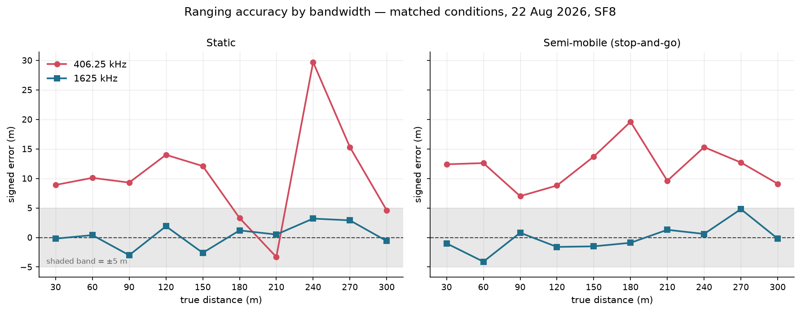
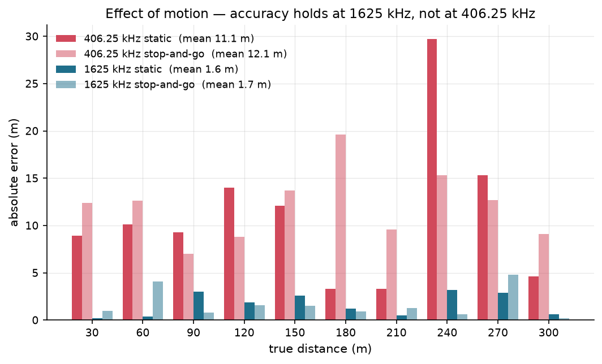
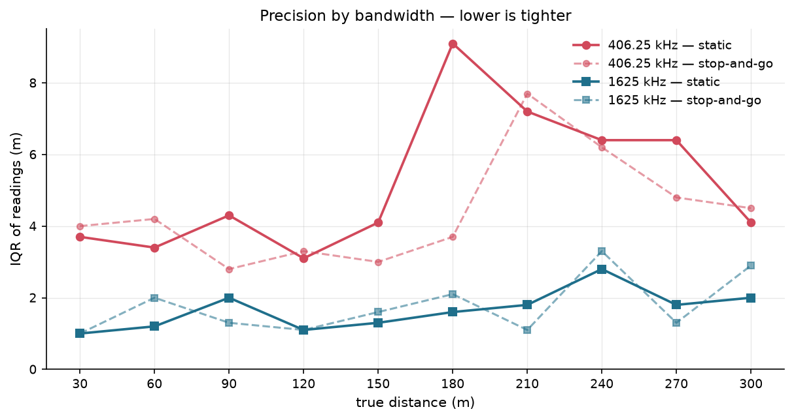

# Pack Pucks

**An open, commodity-hardware platform for peer-to-peer 2.4 GHz radio ranging — and the
field measurements it has produced.**

Two matchbox-sized devices tell each other how far apart they are, using nothing but the
travel time of a 2.4 GHz radio signal between them. No GPS. No phone. No cloud. No fixed
anchors. The measurement build shows the distance on each board's OLED display; a separate
demonstration build maps it to a colour on an LED ring, and that build produced none of
the data here.

The demo is the easy half. The point of this repository is the measurement: firmware,
offload and QC tooling, the raw CSVs from every outing, and the analysis that produced
every number below — published so the ranging behaviour of the SX1280 on off-the-shelf
hardware can be checked rather than taken on trust.

> ### Headline result (one matched session)
>
> **22 August 2026 · ten tape-surveyed cones at 30 m spacing, 30–300 m · SF8 · both
> bandwidths run back to back on the same line**
>
> In this session, at **1625 kHz** the median range error stayed inside **±5 m at every
> marker**, both with the endpoints on tripods and with one endpoint hand-held, with a mean
> absolute error of **1.6 m** and **1.7 m**. At **406.25 kHz** it did not: errors ran
> **10–12 m long on average**, as a systematic bias rather than scatter. The 406.25 kHz
> ranging cycle was **4.7 % longer** than the 1625 kHz one (686 ms against 655 ms).
>
> **7,860 ranging exchanges across the two campaign outings: zero timeouts, zero errors.**
>
> Repeatability across days is not established: a second, non-contribution-grade
> 1625 kHz session at the same marks differs from this one by up to 9.0 m at individual
> markers (see [What these numbers do not say](#what-these-numbers-do-not-say)).

| Where to look | |
|---|---|
| [`data/README.md`](data/README.md) | Datasets — sites, weather, per-session provenance, every field deviation |
| [`data/analysis/2026-08-22_GMATownship_day2_tables_discard5s.md`](data/analysis/2026-08-22_GMATownship_day2_tables_discard5s.md) | The per-marker tables behind every figure here (first 5 s of each marker discarded) |
| [`data/analysis/aggregates.md`](data/analysis/aggregates.md), [`uncertainty.md`](data/analysis/uncertainty.md) | The aggregates below, and their bootstrap and slope intervals |
| [`docs/ground_truth_tolerance.md`](docs/ground_truth_tolerance.md) | How the ground-truth bound was derived |
| [`firmware/`](firmware/) | Arduino/C++ sources, both roles, by build phase |
| [`docs/FSD.md`](docs/FSD.md) | Functional specification — requirements, pin map, CSV schemas |
| [`tools/`](tools/) | Offload, CSV validation, session QC, analysis scripts, figure generation |

---

## Why build it

A group spread out along a forest trail, a trailhead, or a construction site has no
reliable way to answer *"how far away is everyone?"* GPS needs sky, mesh radios need a
network, and phones need both. Two pucks need only each other.

Pack Pucks is **GPS-independent by design** — no GPS receiver, no cellular link, no cloud
service, no fixed anchors. It has **not** been tested in GPS-denied conditions, and no
such claim is made: every measurement in this repository is outdoor and line-of-sight.
The system's output is a coarse range estimate; the LED colour bands are a demonstration
use case, not a research result.

---

## What was measured

| | |
|---|---|
| Site | Open ground, GMA township, Kota, Rajasthan |
| Markers | 10 traffic cones, 30 m spacing, 30 m → 300 m, tape-surveyed |
| Radio | SX1280 @ 2400.0 MHz, SF8, CR 4/7, 12 dBm, address `0x12345678` |
| Calibration | Out of the box: RadioLib 7.6.0's default per-bandwidth calibration constants, no per-device calibration |
| Independent variable | **Bandwidth: 406.25 kHz vs 1625 kHz.** |
| Tier 1 — static | Both endpoints on 1.5 m camera tripods, one boot per marker, ascending 30 m → 300 m |
| Tier 2 — hand-held | Initiator on its tripod; Responder on a pole the operator holds upright at each cone, stationary for a ~70 s dwell, walked between cones in one boot, 300 m → 30 m |
| Sample size | 82–122 attempts per marker after discarding the first 5 s at each marker |
| Tier 2 ground truth | Operator arrival log — phone stopwatch lapped at the end of every dwell and every walk |

Both bandwidths ran back to back on the same cone line, the same afternoon, at the same
spreading factor and the same power, 406.25 kHz first. This is one matched session: the
sweep order was not reversed, ranging is frequency-uncorrected, and the only temperature
reading was taken at 15:07, so drift between the two sweeps cannot be excluded.

---

## Results

All results in this section are from the 22 August session.

### 1. Bandwidth dominated the error



| | 406.25 kHz | 1625 kHz | MAE ratio |
|---|---|---|---|
| Mean absolute error — static | 11.1 m [7.1, 16.1] | **1.6 m** [0.9, 2.3] | 6.8× [4.8, 9.9] |
| Mean absolute error — hand-held | 12.1 m [10.0, 14.3] | **1.7 m** [0.9, 2.7] | 7.2× [4.5, 14.1] |
| Mean signed error — static | **+10.4 m** [+5.6, +15.8] | +0.4 m [−0.9, +1.5] | — |
| Mean signed error — hand-held | **+12.1 m** [+10.0, +14.3] | −0.2 m [−1.5, +1.3] | — |
| Worst single marker — static | **+29.7 m** (at 240 m) | +3.2 m (at 240 m) | — |
| Mean IQR — static | 5.2 m | **1.7 m** | — |
| Mean IQR — hand-held | 4.4 m | **1.8 m** | — |

Each cell aggregates ten per-marker values, where a marker's value is the median (or IQR)
of the SUCCESS rows recorded at it, after discarding the first 5 s at each marker
(Methodology §7.2). Brackets are 95 % percentile intervals of a bootstrap over the ten
markers (10,000 resamples, fixed seed); the MAE ratio is paired by marker. Per-marker
tables are in
[`data/analysis/2026-08-22_GMATownship_day2_tables_discard5s.md`](data/analysis/2026-08-22_GMATownship_day2_tables_discard5s.md);
intervals in [`data/analysis/uncertainty.md`](data/analysis/uncertainty.md).

The 406.25 kHz error is **directional, not noisy** — distances came back too long at nine
of ten markers when static, and at ten of ten when hand-held. No slope against distance
was detectable at this sample size: the 95 % interval for the static slope is −0.070 to
+0.086 m/m, which allows a change of −19.0 to +23.2 m over the 270 m span. A fixed delay
error and an uncancelled oscillator offset would both produce a distance-independent
term, and these data cannot separate them.

### 2. Holding one endpoint by hand changed little at 1625 kHz



At 1625 kHz, mean absolute error was **1.6 m with both endpoints on tripods and 1.7 m with
one hand-held**. At 406.25 kHz it rose from 11.1 to 12.1 m. The two tiers also differ in
boot mode, sweep direction and time of recording, so a difference between them is not
attributable to hand-holding alone.

**What "hand-held" means here, precisely.** The Responder rides on a pole that the
operator holds upright on each cone mark, standing to one side; between cones the
operator walks to the next one (a stop-and-go procedure). The analysed readings come from
the ~70 s dwell at each cone, not from the walk. This is a result about a hand-held
endpoint that is stationary during each measurement window, compared with a tripod one.
It says nothing about ranging in motion.

Dwell windows come from the operator arrival log rather than being inferred from the data.
Where that log disagrees with the QC tool's nearest-marker heuristic — two of ten markers
at 406.25 kHz — the lap-window recomputation supersedes the tool, and the tool's own
report is left as generated so the disagreement stays visible.

### 3. Precision held out to 300 m



1625 kHz stayed between **1.0 m and 3.3 m** of interquartile spread across the whole
30–300 m span. 406.25 kHz ran **2.8 m to 9.1 m**; its widest values (6.2 to 9.1 m) all
fall between 180 and 270 m.

### 4. The narrower bandwidth lengthened the cycle by 4.7 %

Ranging cadence is the duration of the whole firmware loop (the blocking RadioLib
`range()` call, the log write and the OLED refresh), with no software pacing:

| Bandwidth | Cycle time | Rate | Basis |
|---|---|---|---|
| 1625 kHz | **655 ms** | 1.53 Hz | median of 2,649 inter-row intervals |
| 406.25 kHz | 686 ms | 1.46 Hz | median of 3,084 inter-row intervals |

Cutting bandwidth by 4× added only **4.7 %** (31 ms) to each cycle: most of the cycle is
bandwidth-independent loop time, which was not broken down further. What a cycle with no
reply costs was not measured, because neither campaign outing recorded a timeout.

### Practical reading of this session

1625 kHz was better on every axis measured: mean absolute error 6.8× lower static and
7.2× lower hand-held (intervals above), mean IQR 1.7 m against 5.2 m static and 1.8 m
against 4.4 m hand-held, and a cycle 4.7 % shorter. Reach was not the trade-off within
300 m: neither bandwidth lost the link. A separate pilot outing at 1625 kHz was still
ranging at a **365 m** median when the ground ran out — though that outing was never
surveyed, so no accuracy figure can be read from it. These are single-session results.

---

## Where this sits in the literature

| Prior work | Hardware | Bandwidth comparison | Mobility |
|---|---|---|---|
| Wolf et al., WPNC 2019 | SX1280 evaluation board + Raspberry Pi | 406.25 vs 1625 kHz at SF10, dedicated | static |
| Andersen et al., WF-IoT 2020 | SX1280 dev-kit, demonstration firmware | every 400 / 800 / 1600 kHz × SF5–10 combination at each distance | static |
| Müller et al., ICL-GNSS 2021 | custom SX1280 + STM32 | 400 kHz (the 406.25 kHz setting) only | one node carried by a walking person |
| Gottschalk et al., *Internet of Things* 2026 | SX1280 dev-kit, anchor-based 2D | 800 vs 1600 kHz; 400 kHz tested and excluded | static |
| Albinsaid et al., arXiv 2025 | custom hardware; design and firmware released | — (1625 kHz only) | anchor-and-server localisation framework |
| Salimzhanova et al., CSCN 2024 | open SX1280 testbed | — | *communication*, not ranging |

Every bandwidth comparison above is static, and the one study with a person-carried
endpoint (Müller et al.) uses a single bandwidth. Gottschalk et al. explicitly defer
systematic low-bandwidth investigation to future work.

To the best of my knowledge, no prior work compares the 406.25 and 1625 kHz settings with
one endpoint hand-held. This repository does so, out of the box, on commodity hardware
with the raw data published, alongside an open platform for peer-to-peer ranging on
off-the-shelf boards.

The static tier is **not new**. It is a replication of Wolf et al. on off-the-shelf parts
(at SF8 rather than SF10), and is reported as replication. No new per-exchange radio
effect is claimed.

---

## What these numbers do not say

A short, honest list. The full version is in [`data/README.md`](data/README.md) and the
per-session logs.

- **One matched session carries the comparison.** The 406.25-vs-1625 kHz result rests on
  22 August alone. A second session at 1625 kHz only (15 August, same road marks) is not
  contribution-grade: no arrival log for its hand-held run, attempt counts below the
  80-attempt floor, and the 300 m static marker missed and an off-set 330 m cone recorded
  instead. Its static per-marker signed errors differ from those of 22 August by up to
  9.0 m. It is held back pending an operator check of the 15 August set-up, so
  repeatability across days is not established.
- **Ground truth is bounded at about ±0.5 m at 300 m.** The class III tape allows
  ±12.6 mm per 30 m segment, and the same segment was reused ten times, so ±126 mm at
  300 m. With the lateral, mark-transfer and puck-centring terms (operator upper-bound
  estimates), the bound at 300 m is −448 / +281 mm with both endpoints on tripods and
  −411 / +245 mm with one hand-held; the hand-held figure omits the placement of the
  hand-held end, which was not estimated. Cone-position error is shared by both
  bandwidths. Derivation: [`docs/ground_truth_tolerance.md`](docs/ground_truth_tolerance.md).
- **Some set-up details rest on statements after the fact.** The 1.5 m mount height was
  reported by the operator after the campaign; the antenna orientation on the tripods and
  the mount type were not recorded; no site photographs were taken on 22 August.
- **Out of the box only.** Every figure uses RadioLib 7.6.0's default calibration
  constants and no per-device calibration. Ranging is single-direction and
  frequency-uncorrected, without role-swapped or multi-exchange averaging, so the figures
  are not directly comparable with the averaged results of prior work.
- **The 240 m cone stands out at both bandwidths.** +29.7 m at 406.25 kHz static against
  +3.2 m at 1625 kHz, beside a recorded structure; at 1625 kHz its IQR was the widest of
  the ten markers in both tiers (2.8 m and 3.3 m). Other markers stand out by other
  criteria (the widest 406.25 kHz IQRs were at 180 m and 210 m). These are recorded as
  observations and not interpreted; re-measurement is future work.
- **The pilot outing has no ground truth at all.** Its 365 m reach is a range
  demonstration; positions were paced, not surveyed. No accuracy figure is derivable
  from it.
- **Nothing here speaks to continuous motion.** See result 2 above.

---

## Reproducing every figure

Raw CSVs are opened read-only and never modified — no ground truth was ever written back
into them, which is why per-file truth lives in `session_plan.json` instead. Every report
and figure regenerates from the published data. The per-session QC reports:

```bash
python tools/qc_session.py --data-dir data/ranging_experiments/2026-08-22_GMATownship_session02/raw/20260822_174415-Initiator --out qc_out --session-plan data/analysis/2026-08-22_GMATownship_174415_qc/session_plan.json --expect-bw 1625.0
```

For the 406.25 kHz run add `--expect-bw 406.25 --cadence-ms 686.0`. Regenerating
reproduces the committed reports exactly; only the generation timestamp differs.

The post-discard analysis and the figures above, in this order (later scripts read
earlier outputs; each writes into `data/analysis/`):

```bash
python tools/per_marker_tables.py
python tools/aggregates.py
python tools/c3_filters.py
python tools/c4_failure_modes.py
python tools/dwell_table.py
python tools/uncertainty.py
python tools/rssi_disturbance.py
python tools/make_readme_figures.py
```

These regenerate the committed files under `data/analysis/` exactly.
`tools/make_latex_tables.py` writes the preprint's LaTeX tables from the same outputs.

---

## Build one

### Hardware

| Component | Part |
|---|---|
| MCU + radio + display | LILYGO T3-S3 V1.2 — ESP32-S3 + Semtech SX1280, *Without PA* (H594), onboard SSD1306 OLED × 2 |
| Antenna | the 2.4 GHz SMA stub antenna supplied with the board, finger-tight |
| Power | USB-C — laptop, wall adapter or power bank |
| Mounts (measurement) | 1.5 m camera tripods; a pole for the hand-held endpoint |
| Ground truth | Freemans Grey Magic 30 m fibreglass tape, class III |
| Demonstration only | WS2812B 16-LED ring on GPIO 38, for the colour-band demonstration build; not used for any data in this repository |

Both boards run the same code with one compile-time switch. One is the Initiator and
drives the exchange; the other answers.

### Toolchain

Arduino IDE 2.x with ESP32 board support, plus **RadioLib** (Jan Gromeš; the campaign data
used 7.6.0) and **U8g2** (OLED) from the Library Manager. **FastLED** (Daniel Garcia) is
needed only for the LED-ring demonstration build.

### Flash

1. Open the sketch for the phase you want from `firmware/`.
2. Board **LilyGo T3-S3**, Board Revision **Radio-SX1280**.
3. Enable **USB CDC On Boot**; PSRAM **QSPI PSRAM**; Partition Scheme
   **Default 4MB with spiffs**.
4. Set the role — `#define ROLE_INITIATOR` on one board, `#define ROLE_RESPONDER` on the
   other. There is no runtime switching.
5. Flash both, then open Serial Monitor at 115200 baud.

The boot banner reports firmware version, board ID and the full radio configuration, and
confirms WiFi and Bluetooth are off. If either fails to disable, the board faults rather
than collecting data.

The campaign data were recorded with `firmware/03_ranging/` at tag
`v0.9-field-hardening` (commit `562f991`). `RADIO_BW_KHZ` was edited and both boards
reflashed for each bandwidth sweep; each CSV header records the bandwidth that produced it.

### Radio configuration

One `#define` block drives `radio.begin()`, the boot banner and the CSV header, so every
logged file self-describes the settings that produced it.

```cpp
#define RADIO_FREQ_MHZ     2400.0f  // MHz
#define RADIO_BW_KHZ       1625.0f  // kHz — or 406.25f
#define RADIO_SF           8        // spreading factor
#define RADIO_CR           7        // coding rate 4/7
#define RADIO_TX_POWER_DBM 12       // H594 hardware max ~12.5 dBm
#define RADIO_ADDRESS      0x12345678
```

Two notes that cost time to discover. Semtech's documentation labels the 1625 kHz setting
"1600 kHz", but the hardware register is 52 MHz / 32 = 1625 kHz — and RadioLib rejects
`1600.0` and `400.0` outright. The address must match on both boards or they will never
pair.

### Collecting data

Logs are written to on-board flash as CSV and pulled off over serial afterwards:

```bash
python tools/offload/offload.py --port COM8 --session-id 20260822_site
```

The script prompts for session metadata, converts local timestamps to UTC, validates every
file against the DR-1/DR-2 schema, verifies it against a byte-count manifest, and only
then offers to wipe the flash — a file that fails validation blocks the wipe. Wipe between
outings: leaving it unwiped is how one of our own offloads ended up mixing three firmware
versions' worth of stale recordings into what looked like a single session.

---

## Repository layout

```
firmware/   Arduino sketches by phase — 01_blink, 02_radio_comms, 03_ranging
tools/      offload.py + validate_csv.py   flash -> verified CSV
            qc_session.py                  per-session QC reports and figures
            per_marker_tables.py, aggregates.py, c3_filters.py, c4_failure_modes.py,
            dwell_table.py, uncertainty.py, rssi_disturbance.py
                                           post-discard analysis behind the preprint
            make_readme_figures.py         the cross-bandwidth figures above
            make_latex_tables.py           the preprint's LaTeX tables
data/
  ranging_experiments/   raw CSVs, manifests, session logs, field notes, weather
  analysis/              generated QC reports, per-marker tables, analyses, figures
docs/FSD.md              functional specification — requirements, interfaces, schemas
docs/ground_truth_tolerance.md   ground-truth bound derivation
```

---

## Status

**Working today:** two-board ranging at both bandwidths, on-device CSV logging, the
offload / validation / QC pipeline, the post-discard analysis scripts, and three
completed field outings across two sites.

**Next:** a second matched session with the sweep order reversed, so the bandwidth
comparison rests on more than one day; the operator check of the 15 August set-up;
re-measuring the 240 m marker at both bandwidths with site photographs; and a per-device
delay calibration at each bandwidth.

**Paper:** a Part 1 preprint covering the platform and this characterisation is in
preparation, targeted at arXiv for late 2026. The full experimental protocol
(`Methodology.md`) — survey procedure, sample sizes, session structure, environmental
logging, and the discard criteria the QC tool enforces — will be published alongside it,
and is available on request before then.

**Out of scope for now:** battery operation, ranging while both endpoints are in
continuous motion, indoor multipath characterisation, crash detection, and ranging between
more than two devices.

---

## Documentation

| Document | Purpose |
|---|---|
| [`docs/FSD.md`](docs/FSD.md) | Functional specification — requirements, interfaces, data schemas, acceptance criteria |
| [`data/README.md`](data/README.md) | Datasets — sites, conditions, per-session provenance, limitations, reproduction |
| [`data/analysis/2026-08-22_GMATownship_day2_tables_discard5s.md`](data/analysis/2026-08-22_GMATownship_day2_tables_discard5s.md) | Per-marker numbers behind every figure in this README |
| [`docs/ground_truth_tolerance.md`](docs/ground_truth_tolerance.md) | Ground-truth bound: inputs, terms and per-marker bounds |
| [`tools/qc_session.py`](tools/qc_session.py) | Session QC tool — generates the per-session reports and figures under `data/analysis/` |

---

## Author

Built and measured by **Ishan Raonka** — [ishan.raonka.com](https://ishan.raonka.com/).

Corrections, replication attempts, and requests for `Methodology.md` are welcome: open an
issue on this repository.

## License

Not yet set. The firmware, tools and datasets here are published for inspection and
replication; a formal licence will be attached before the preprint goes live.
